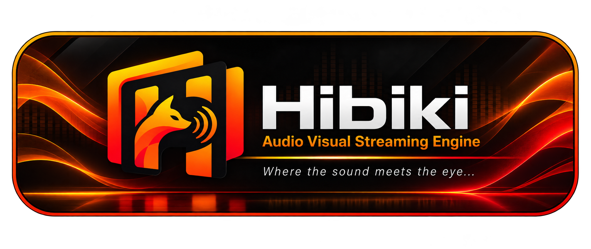
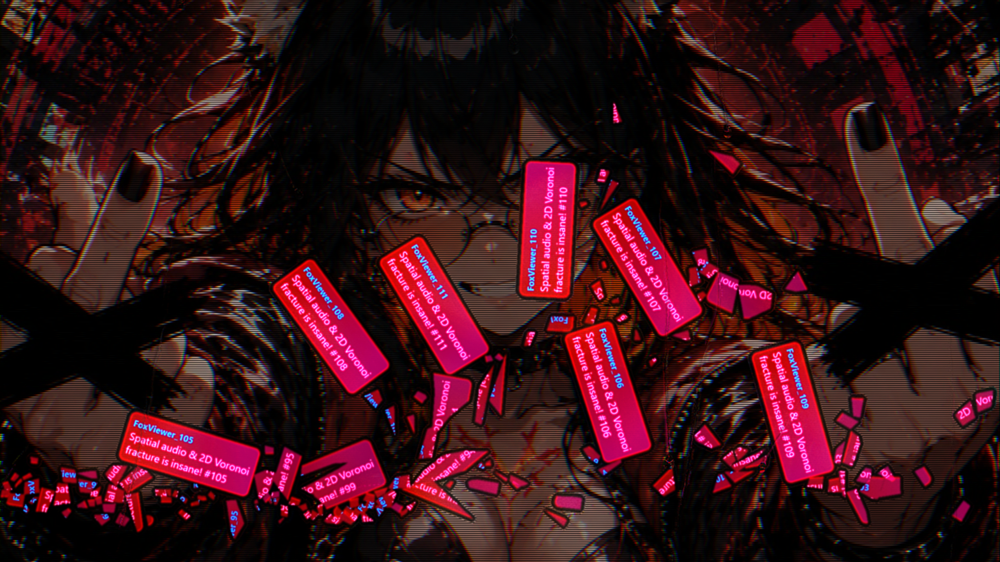
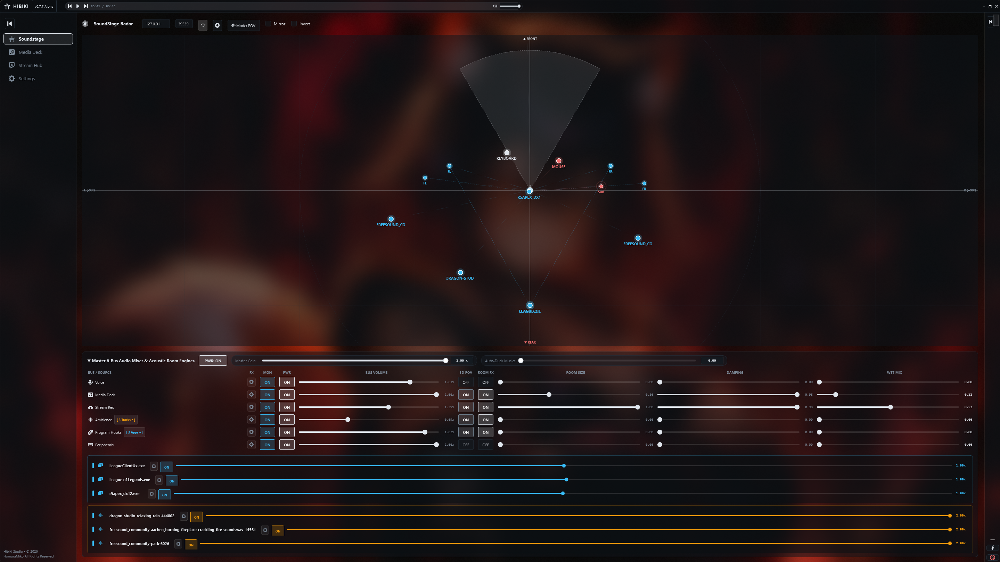
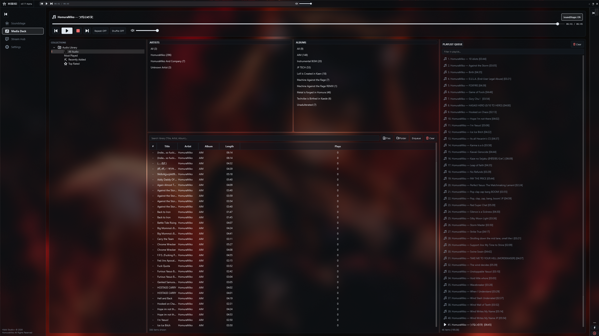
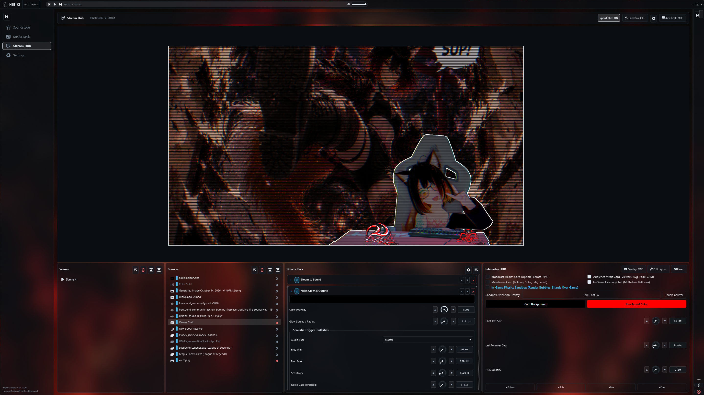
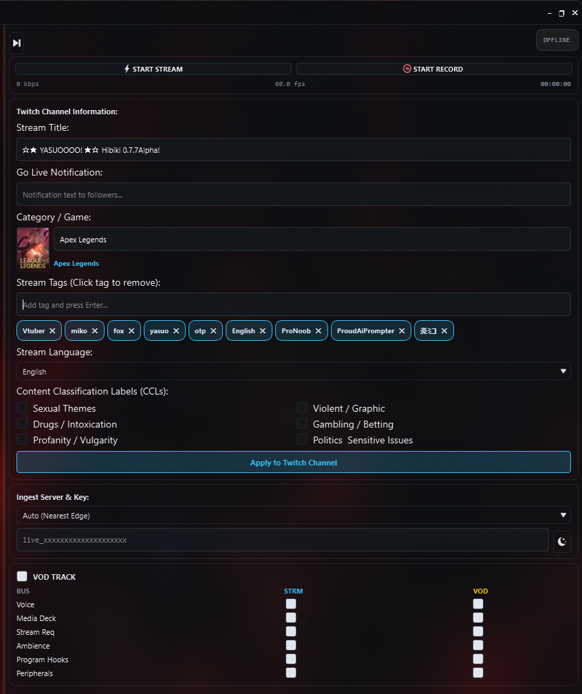

[HibikiStudio Discord](https://discord.gg/Jxj3nQwKj) | [Download Latest Version](https://github.com/HomuraMiko/HibikiStudio/releases/latest)

# Hibiki Studio

**A standalone, hardware-accelerated Audio Visual Streaming Engine for Windows.**

Hibiki brings broadcasting, audio processing, visual effects, physics, and audience interaction together in one native application.

Create scenes, customize your canvas, process audio, interact with your audience, and build unique streaming experiences without relying on a pile of external tools.

Whether you want a simple streaming setup or an interactive audiovisual playground, Hibiki gives you the tools to build it your way.

---

***The background image displayed behind the software is my personal wallpaper and NOT a hardcoded application asset.***

---

## Features

- **Canvas & Scenes** - Build custom layouts using images, text, captures, media, and Spout2 sources.
- **Visual Effects** - GPU-accelerated shaders, filters, transitions, and audio-reactive effects.
- **Physics Sandbox** - Bring your canvas to life with interactive objects, collisions, and audio-reactive physics.
- **Logic & Node Graph** - Create custom automations using events, conditions, and actions.
- **Twitch Integration** - Chat, animated emotes, alerts, and interactive viewer experiences.
- **Audio Engine** - Multiple independent audio buses with built-in DSP processing and spatial audio.
- **MediaDeck** - Integrated media playback, playlists, metadata, and audio management.
- **Soundstage** - Three-dimensional audio positioning and VMC tracking integration.
- **StreamHub** - Integrated streaming and local recording with hardware-accelerated encoding.
- **Hibiki API** - Connect external tools and integrations to Hibiki.

---

## Compatibility

- Windows 10 / Windows 11 (64-bit).
- NVIDIA, AMD, and Intel hardware encoding support.
- Dedicated GPU recommended.
- Spout2 output available for external broadcasting workflows.

---

## Links

- [Discord Community](https://discord.gg/Jxj3nQwKj)
- [GitHub Repository](https://github.com/HomuraMiko/HibikiStudio)
- [Latest Releases](https://github.com/HomuraMiko/HibikiStudio/releases/latest)

---

*Hibiki Studio • Copyright © 2026 HomuraMiko™ All Rights Reserved.*

*Where the sound meets the eye...*
