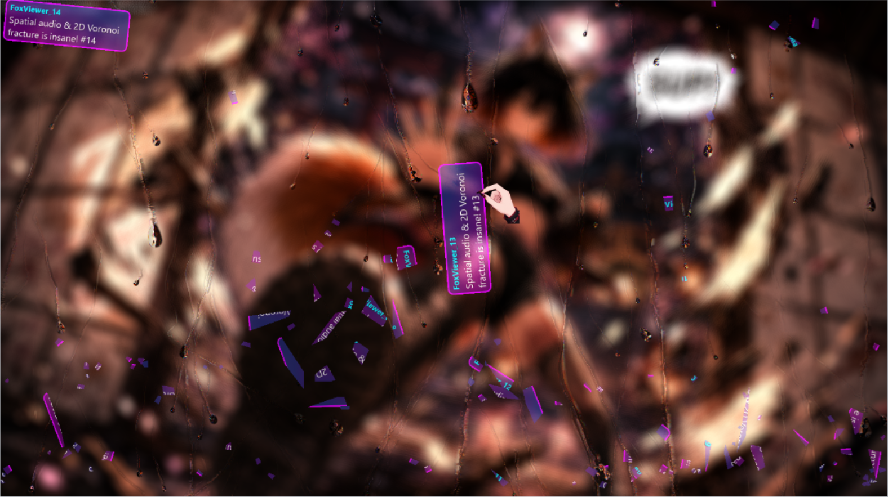
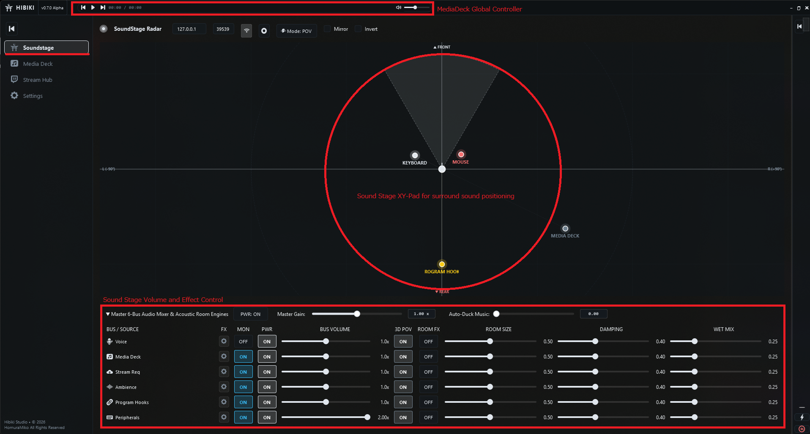
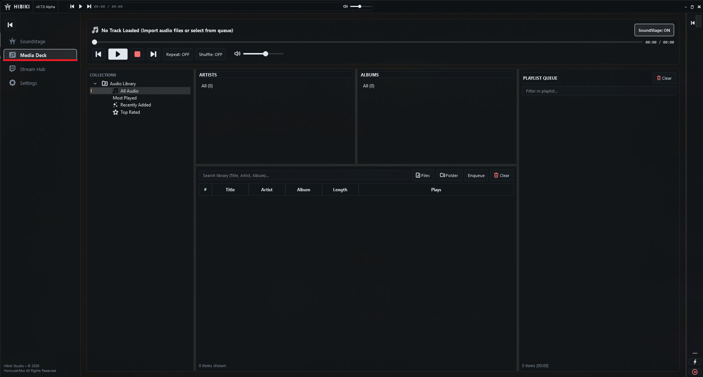
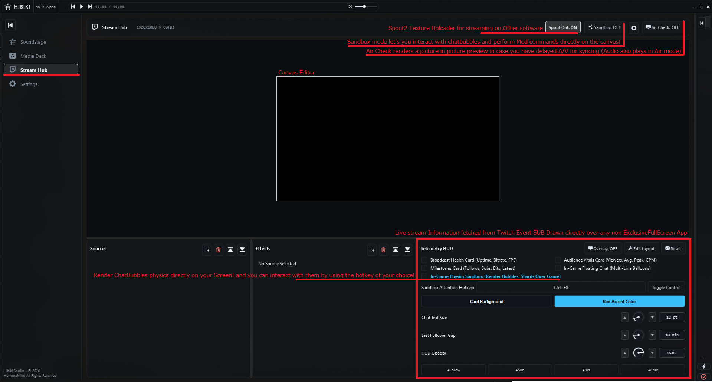
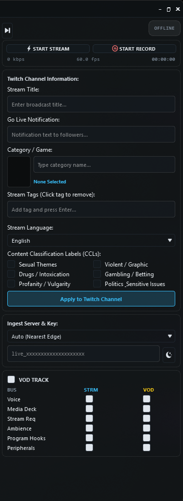

[Download latest version](https://github.com/HomuraMiko/HibikiStudio/releases/tag/V0.7.X)

# Hibiki (v0.7.6 Alpha)

**Standalone, hardware-accelerated broadcasting and interactive content creation workstation.**

Hibiki is a native C++20 application built from the ground up to replace the bloated stack of external browser sources, virtual audio cables, third-party chat overlays, separate media players, and bot runners. Canvas compositing, multi-bus audio routing, DSP chains, hardware video encoding, 2D rigid/softbody physics, automated media requests, and in-game overlays are built directly into a single unified binary with zero web-bloat dependencies.

---











---

## What Hibiki Does

* **Direct3D 11 Master Canvas**: Hardware-native scene compositing with zero-copy texture sharing, 2D/3D planar transforms, and sub-pixel antialiasing.
* **Jolt Physics Sandbox**: Full physical 2D simulation for chat bubbles, media items, and props with organic grabbing, throw kinematics, mechanical hinge pinning, and cellular Voronoi glass fracture.
* **28+ GPU Shader Effects**: Hardware-accelerated post-processing pipeline featuring perceptual OKLab chroma keying, analog CRT/VHS degradation, normal-mapped fluted glass, CPU-simulated rain droplets, and audio-reactive motion.
* **Interactive Viewer Chat & Alerts**: Chat messages drop as physical objects or clean list stacks. Features full support for 7TV and Twitch animated emotes, custom gradient styling, and a 2-phase alert showcase engine.
* **Automated Song Requests**: Embedded headless Chromium browser running a 3-tier adblock firewall and routing audio directly through a lock-free WebAudio-to-WebSocket PCM bridge.
* **Multi-Bus Audio Engine & DSP Rack**: 6 discrete stereo buses with chainable studio filters (Compressor, Expander, Noise Gate, Limiter, 3-Band Parametric EQ, Pitch/Formant Shifter), relative timeline delay alignment, auto-ducking, and FDN 8-delay reverberation.
* **In-Game Telemetry HUD & Overlay**: A transparent, click-through desktop overlay providing live broadcast health, audience metrics, floating chat balloons, and an in-game hotkey to control physics directly over full-screen games.
* **MediaDeck**: Built-in multi-format audio player with local tag parsing, auto-ducking, playlist queuing, and smooth volume crossfading.
* **Direct Hardware Broadcasting**: Native NVENC H.264 video encoding, Media Foundation AAC encoding, and raw RTMP streaming to Twitch without OBS.

---

## Canvas Compositing & Scene Architecture

Hibiki renders scenes using an offscreen Direct3D 11 render target with interactive viewport controls, 1:1 pixel scaling, letterboxing, and magnetic grid snapping.

### Supported Canvas Sources

1. **Window / Application Capture**:
   * Uses the Windows Graphics Capture (WGC) API for hardware zero-copy texture sharing.
   * Auto-rehook engine monitors processes by Executable Name, Exact Title, or Partial Match, seamlessly re-attaching when applications restart.
   * Optional mouse cursor capture and integrated WASAPI process-loopback audio capture.
2. **App Audio Capture**:
   * Captures application audio directly via process loopback without creating visual canvas geometry, automatically routing to Bus 4 (Program Hooks).
3. **Media Request (YouTube Video Player)**:
   * Direct hardware-accelerated video playback from automated chat requests.
   * Can run as a standard canvas billboard or drop directly into the Jolt physics arena as a dynamic, breakable item.
4. **Spout2 Receiver**:
   * Ultra-low-latency inter-process VRAM frame sharing for 3D VTuber avatars (Warudo, VSeeFace, etc.). Hibiki also includes a Spout2 Sender to broadcast the master canvas.
5. **Image Source**:
   * Supports PNG, JPG, BMP, and WebP with custom 32-ray radial alpha contour extraction for collision hulls.
6. **LiveCard Text Source**:
   * Dynamic token-replacement engine supporting `{NowPlaying}`, `{TrackTime}`, `{TrackRemaining}`, `{Date}`, `{Time}`, and `{Uptime}`.
   * Features independent vector scale locking, drop shadows, and stroke outlines with zero aspect-ratio distortion.
7. **Color Solid**:
   * Solid color backdrops and cutouts with alpha transparency controls.
8. **Viewer Chat**:
   * Houses the physical chat bubble arena, emoji pile, and dynamic Twitch event alert cards.

### Scene Management & Transitions

* Manage unlimited scenes with drag-and-drop hierarchy reordering.
* **Source Deduplication (`SourceRegistry`)**: Captures, textures, and audio hooks are reference-counted across scenes. Switching scenes never resets video hooks or drops audio streams.
* **GPU Transitions**:
  * **Cut**: Instantaneous frame swap.
  * **Fade**: Smooth cubic Hermite film dissolve.
  * **Slide**: Directional push transition.
  * **Luma Wipe**: Soft-edged gradient mask wipe.
  * **Glitch / Cyberpunk Tear**: Dynamic block displacement with RGB chromatic tearing.
  * **Physics Shatter**: Converts the outgoing scene snapshot into an organic spider-web fracture pattern (8–36 spokes, 3–12 stress rings) with shockwave propagation delays and a 3D specular point-light reflection pass.

---

## 28+ Built-in GPU Shaders & Visual Effects

All filters run in 32-bit floating-point precision through a shared Direct3D 11 ping-pong scratch pool:

### Color & Keying

* **Color Correction**: Full controls for Brightness, Contrast, Saturation, Gamma curve, 360° Hue shift, Color Tint, and Opacity.
* **Color Key**: Simple Euclidean RGB color distance keyer with similarity and edge feathering.
* **ChromaKey (Fast)**: Standard YCbCr chroma distance keyer with integrated spill suppression.
* **ChromaKey (Quality)**: Advanced perceptual keyer operating entirely within the **OKLab color space**. Features separate Hue, Lightness, and Chroma tolerance metrics with optical color unmixing for edge despill.
* **Luma Key**: Extracts highlights or cuts shadows with smoothstep edge feathering and invert toggle.

### Audio-Reactive Filters

* **Scale to Sound**: Real-time geometric scaling bound to specific audio frequency bands (Center, Bottom-Center, or Top-Center anchors).
* **Shake to Sound**: Audio-driven high-frequency translation jitter and rotational wobble.
* **3D Rotate to Sound**: Dynamic Pitch, Yaw, and Roll oscillation kicks driven by bass energy.
* **Bloom to Sound**: Soft-knee threshold luminance bloom using a 16-to-128 tap Vogel golden-angle spiral sampling pattern.
* **Neon Glow & Outline**: Edge-detection glow that pulses and expands based on live bus transients.

### Retro, Analog & Distortion

* **CRT Glitch & VHS**: Geometric barrel screen curvature, phosphor scanlines, localized horizontal tracking glitch blocks, and chromatic aberration.
* **VHS Tape**: Authentic analog tape transport emulation with motor speed jitter, rolling tracking noise bars, head-switching bottom edge tearing, and YIQ color subcarrier horizontal bleed.
* **Halftone / Dot Matrix**: Simulates an angled 4-color CMYK newspaper rosette print (15°, 75°, 0°, 45°) or a 4-shade greenish Game Boy LCD dot matrix.
* **Datamosh Glitch**: MPEG macroblock corruption with time-stepped motion vector drift, chromatic tearing, and 2-to-8 bit color depth quantization.
* **Pixelate / Mosaic**: Square grid, 45° diamond mosaic, or hexagonal honeycomb pixelation with adjustable edge-bevel shading.
* **Lens Distortion**: Brown-Conrady barrel, pincushion, and fisheye distortion with cubic edge warp and anamorphic aspect ratio compensation.
* **Heat Haze & Underwater**: Sinusoidal dual-octave fluid turbulence with flow direction control and chromatic ray dispersion.
* **Textured Glass / Normal Map Refraction**:
  * *Fluted Glass*: Procedural ribbed architectural glass distortion.
  * *Animated Rain on Glass*: Uses a dedicated CPU simulation (`RainSim`) tracking droplet mass, acceleration, stick-slip friction, merging, and surface runoff. Droplets clear condensation, create teardrop refractions, and carve dynamic water rivulets in the condensation mist.
  * *Custom Normal Map*: Loads custom user normal maps to refract background elements.
* **Frosted Glass (Acrylic)**: Dual-pass blur and chromatic aberration sampling whatever canvas elements sit behind the layer with frosted etch noise and glass tinting.

### Styling & Optical Tools

* **Drop Shadow & Outer Glow**: Directional drop shadow or omnidirectional outer halo with 16-tap Vogel spiral blur and a "Shadow Only" cutout toggle.
* **Comic Edge Outline**: 8-way perimeter Laplacian silhouette detection for cel-shaded anime outlines.
* **Sepia**: Vintage warm amber/copper tone mapping.
* **Night Eye**: Phosphor-green night-vision sensor simulation with luma amplification, scanlines, lens vignette, and sensor noise.
* **Sharpening Suite**:
  * *Standard Sharpen*: Laplacian high-pass kernel with anti-halo overshoot clamping.
  * *Luma Sharpen*: Perceptual Rec.709 luminance edge boost with shadow noise coring to prevent film-grain amplification.
  * *Blur to Sharpen*: Continuous bipolar slider transitioning from a soft defocus blur into an adaptive unsharp mask.
* **Retro Pixel Upscalers**:
  * *Scale2x / EPX*: Classic 90s pattern-matching pixel doubler.
  * *xBR*: Directional vector edge smoother for clean hand-drawn pixel scaling.
  * *2xSaI*: Smooth corner-rounding interpolation.
  * *Sharp Bilinear*: Constrains bilinear filtering strictly to the 1-pixel boundary of retro pixels to eliminate scrolling shimmer while preserving crisp pixel art.
* **Blur Suite**: Gaussian Blur, Box Blur, Directional/Motion Blur, and Radial Zoom Blur.

---

## Interactive Physics Sandbox & Mechanics

Hibiki integrates the **Jolt Physics** engine directly into the canvas for 2D rigid, softbody, and particle simulations.

```
                              [ User Mouse / Hand ]
                                        │
                ┌───────────────────────┴───────────────────────┐
                ▼                                               ▼
         [ Left Click ]                                  [ Right Click ]
                │                                               │
   ┌────────────┴────────────┐                           ┌──────┴──────┐
   ▼                         ▼                           ▼             ▼
[ Hit Plate ]           [ Empty Air ]              [ On Bubble ]   [ Near Pin ]
   │                         │                           │             │
   ├─ Pinch Pose             ├─ Touch Pose               ├─ Shatter    └─ Unpin Joint
   ├─ Lift-Pop Dynamics      └─ Draw Telestrator Ink     ├─ Add Pin Hinge
   └─ Inertial Throw / Yeet                              └─ Mod Actions
```

### Hand Kinematics & Secondary Motion

* **Animated Vtuber Hand**: A responsive on-screen claw/hand with 8 distinct gestures (Pointer, Touch, Palm, Claw, OK, ThumbsUp, ThumbsDown, Pinch).
* **Kinematic Solver**: Calculates directional velocity, banking tilt angles, spring oscillations, and volume-preserving squash-and-stretch based on mouse acceleration.
* **Custom Skinning**: Load custom hand/paw atlas PNG sprite sheets directly through the Sandbox settings.

### Interactive Sandbox Manipulation

* **Direct Grab & Throw**: Click and drag any chat bubble, media request, image, or shard. Objects swing dynamically around the grab point with pendulum torque and angular whip momentum.
* **Mechanical Hinge Pins**: Right-click any object to insert an axle pin. One pin creates a freely swinging pendulum hinge; two pins lock the object completely in place. Remove pins to drop objects back into gravity.
* **Watertight Cellular Voronoi Shatter**:
  * Rigid bodies contain a full graph of Voronoi cells joined by structural bonds.
  * High-force collisions or manual shatter actions sever local bonds. Breadth-First Search (BFS) separates disconnected cell clusters into independent physical rigid bodies.
  * Single cells that exceed impact thresholds cleave along their major axis until hitting the break-step limit, at which point they pulverize into glass dust.
* **Softbody Jello Balls**:
  * 16-node perimeter spring lattice with radial firmness springs, cross-strut volume preservation, and jiggle damping.
* **Party Balloon Rocket Physics**:
  * Bursting or evicting balloon items activates rogue jet propulsion, rocketing them across the screen with nozzle exhaust and angular torque before flying offscreen.
* **Subwoofer Floor Kick**:
  * The bottom container wall acts as an acoustic piston, violently kicking upward on bass transients (driven by MediaDeck, Master, or Microphone audio) to toss resting items into the air.
* **Telestrator Ink**:
  * Draw glowing phosphor lines directly on the canvas with the Touch hand gesture. Strokes dissolve over time with ribbon joint smoothing.

---

## Viewer Chat, Emotes & Dynamic Alerts

The `ViewerChatElement` connects directly to Twitch IRC over secure WebSockets with zero third-party browser source dependencies.

### Layout & Flow Modes

1. **Clean List**: Studio-style message stack with smooth critically-damped spring interpolation. Can flow Bottom-to-Top, Top-to-Bottom, Left-to-Right, or Right-to-Left.
2. **Sloppy Springs**: Organic sticker-collage layout with randomized tilt angles, positional jitter, and audio-reactive harmonic wobble.
3. **Gravity Pile**: Freefall Jolt 2D physics sandbox. Bubbles tumble, collide, and stack with natural bounciness and upright spring correction.

### Chat Styling & Capabilities

* **Emoji Pile**: Messages consisting entirely of emotes spawn individual bouncy sprites or softbody jello blobs into the gravity pile.
* **Watertight Emote Engine (`EmoteManager`)**: Native multi-frame GIF/WebP decoder with disk caching and an LRU GPU VRAM cache. Automatically fetches 7TV channel and global emote sets alongside native Twitch emotes.
* **Custom Glass Bubble Styling**: Configurable gradient angles, color stops, rim bevels, studio specular highlights, drop shadows, and role-based rim tints (Broadcaster, Mod, VIP, Subscriber, Viewer).
* **Monitor-Only Audio Chime**: Configurable chat notification sound with an inactivity cooldown to prevent spam during active conversations.

### 2-Phase Dynamic Alerts

Twitch alerts (Follows, Subs T1–T3, Gifted Subs, Bits 1–5000+, Raids) operate on an alert engine:
* **Phase 1 (Showcase Spotlight)**: The alert card spawns at the top of the screen (Left, Center, or Right) as a kinematic entity, remaining in place for a configurable duration.
* **Phase 2 (Arena Drop)**: The alert drops into the physics arena.
  * *Juggernaut Touch*: Heavy alert cards crush through the invulnerability shields of regular chat bubbles on contact.
  * *Radial Shockwave*: Triggers an explosive impulse wave on impact, scattering nearby objects.
  * Subwoofer slam coupling violently kicks the floor piston upon landing.

---

## Automated Media Requests & Headless Browser

Hibiki features an embedded media request pipeline powered by an offscreen `QWebEngineView` and native C++ audio streaming:

```
[ Twitch Chat: !sr <query/link> ]
               │
               ▼
   [ StreamRequestManager ]
         ├─ Role & Cooldown Verification
         ├─ Async Metadata Resolver (InnerTube / HTML / Invidious)
         └─ Threat Assessment (Blacklist / Keyword / Whitelist Filter)
               │
               ▼
   [ Headless YouTubeBrowser ]
         ├─ Tier A: Pre-Execution JS Defuser (Strips ad slots from fetch/player responses)
         ├─ Tier B: Runtime Automation (1ms ad skip fallback, quality lock, auto-play)
         ├─ Tier C: C++ URL Interceptor (Blocks ad network domains)
         ├─ Zero-Copy WGC Video Capture (D3D11 Texture -> Master Canvas)
         └─ WebAudio ScriptProcessor Node
               │
               ▼ (Interleaved Stereo PCM Float32 @ 48kHz)
    [ AudioWebSocketBridge ] (Dedicated High-Priority Socket Server)
               │
               ▼
 [ MediaStreamJitterBuffer ] (SPSC Lock-Free Ring Buffer)
               │
               ▼
[ AudioEngine: Bus 2 (StreamReq) ] (Dedicated EQ, Gate, Ducking, Reverb)
```

* **No Speaker Leakage**: DOM audio output is clamped to zero gain; audio is extracted via `createMediaElementSource` and piped through an internal WebSocket bridge (`AudioWebSocketBridge`) directly into a lock-free jitter buffer read by `AudioEngine`.
* **Automated Threat Assessment**: Scans titles and channels against blacklists and high-risk keywords (earrape, screamer, 130dB) while skipping verified whitelisted partners.
* **Smart MediaDeck Coordination**: Automatically pauses local MediaDeck playback when a song request begins, cleanly resuming it once the request queue empties.
* **Climax Shatter Event**: Media request billboards in the physics arena automatically fracture into Voronoi shards exactly 5 seconds before the video ends.
* **Peep-Hole Window**: A dedicated toggle uncloaks the headless browser into a native desktop window for manual CAPTCHA solving or account login.

---

## Multi-Bus Audio Engine & DSP Architecture

Operating strictly at 48kHz stereo, the audio engine uses a 512-frame hardware buffer period (~10.67ms latency):

### Discrete 6-Bus Routing Matrix

* **Bus 0: Voice**: Microphone input with lock-free SPSC jitter cushioning and de-clicking crossfades.
* **Bus 1: Media Deck**: Internal audio player stream with real-time pre-fader visualizer taps.
* **Bus 2: Stream Requests**: Embedded YouTube audio stream with headroom calibration.
* **Bus 3: Ambience / BGM**: Dedicated background audio loops.
* **Bus 4: Program Hooks**: Audio captured from external applications via WASAPI process loopback.
* **Bus 5: Peripherals**: Mechanical keyboard and mouse sound profiles triggered via low-level Windows hooks (`WH_KEYBOARD_LL`, `WH_MOUSE_LL`).

### Per-Bus DSP Filter Racks

Each bus can host an arbitrary chain of real-time filters:
1. **Gain & Polarity**: Phase inversion (L/R) with smoothed gain trim.
2. **3-Band Parametric EQ**: Studio biquad shelving and bell filters.
3. **Noise Gate**: Dual-threshold hysteresis gate with attack, hold, and release controls.
4. **Downward Expander**: Smooth sub-threshold gain reduction.
5. **Dynamic Compressor**: Soft-knee downward leveler with makeup gain.
6. **Upward Compressor**: Low-level nuance booster for whispers and quiet audio.
7. **Peak Limiter**: Brickwall true-peak ceiling guard.
8. **Spectral Noise Suppression**: Background room-tone and HVAC reduction.
9. **Bandpass Transceiver**: Bandpass telephone/walkie-talkie filter with saturation drive.
10. **Dynamic Envelope Filter**: Speech-adaptive envelope auto-wah filter.
11. **Pitch & Formant Processor**: Dual-grain shifter for pitch and formant manipulation.
12. **Resonant Notch Filter**: High-Q notch filter for 50/60Hz ground hum removal.

### Spatial Audio & Acoustic Room Engines

* **Binaural Positioning**: Simulates interaural time delay (ITD), head-shadow lowpass filtering, and pinna notch reflections.
* **Acoustic Room Engine**: Each bus features an independent Feedback Delay Network (FDN) 8-delay room reverb.
* **Ghost Pipes**: Can spawn lightweight, zero-GUI worker processes (`HibikiPipe.exe`) to route individual buses to dedicated physical or virtual audio endpoints for legacy capture setups.
* **Timeline Sync & Air Check**:
  * Relative delay engine: Setting a negative delay on Voice (for heavy AI voice changers) shifts all other streams and the video canvas forward in time, keeping the broadcast in sync while retaining zero-latency headphone monitoring.
  * Air Check mode crossfades headphone monitoring to the delayed broadcast stream with a picture-in-picture video confidence monitor.

---

## In-Game Telemetry HUD & Overlay

The HUD overlay is a transparent window that renders over games:

* **Broadcast Health Card**: Uptime, network bitrate, framerate, and encoder health.
* **Audience Vitals Card**: Live viewer count, peak viewers, session average, and rolling Chats Per Minute (CPM).
* **Milestones Card**: Follower, subscriber, and cheer tallies alongside an event ticker.
* **Floating Chat Box**: Multi-line chat balloons with rendered animated emotes.
* **In-Game Sandbox Interaction**:
  * Press the global hotkey (`Ctrl+F8` by default, remappable) to capture control over full-screen games without Alt-Tabbing.
  * Click, drag, pin, or shatter physics bubbles directly over your game with zero click bleeding. Pressing the hotkey again instantly restores input focus to the game.
* **Interactive Layout Editor**: Drag and reposition HUD cards on-screen with snap-to-edge constraints.

---

## MediaDeck Audio Player

* Native ID3v2, Vorbis Comments, and RIFF INFO tag parsing (MP3, FLAC, WAV, OGG).
* Background prefetch thread maintaining a 2-second streaming ring buffer (768 KB RAM footprint).
* Playlist management: Drag-and-drop reordering, insert as next, batch metadata editing, and folder ingestion.
* Titlebar mini-controller with ambient progress fill and playback controls.
* Auto-ducking engine smoothly attenuates music volume when microphone audio or peripheral typing is detected.

---

## Broadcasting, NVENC & Output Station

* **Hardware Video Encoding**: Hardware-accelerated H.264 video encoding via the NVIDIA NVENC API (supports CBR, CQP, VBR; presets P1–P7; low-latency tuning; lookahead; spatial adaptive quantization).
* **Audio Encoding**: Dual stereo AAC encoding via Windows Media Foundation MFT (160–320 kbps).
* **RTMP Streaming Engine**: Connects directly to Twitch ingest servers with low-latency `TCP_NODELAY` and a 512KB socket send buffer.
* **Local Recording**: Zero-overhead recording to Flash Video (`.flv`) containers with frame-accurate timecode synchronization.
* **Twitch Helix API Integration**: Update broadcast title, game category (with box art previews), language, tags, and Content Classification Labels (CCLs) directly from the application.

---

## Current State & Known Limitations

This release is in active alpha development:

* **NVENC Only**: Hardware video encoding currently requires an NVIDIA GPU (GeForce GTX 600 series or newer). AMD AMF, Intel QuickSync, and software x264 encoders are not yet implemented.
* **Dual-Track Stream/VOD Audio Separation**: While independent bus assignment UI exists, secondary audio track routing for Twitch VOD music exclusion is currently under active development and may exhibit routing bugs.
* **VMC Head Tracking**: The 6-DoF OSC listener for Virtual Motion Capture (VMC) is present in the codebase, but the head orientation and quaternion-to-head spatial coordinate transformations have known calculation quirks; a full overhaul is planned for a future update.

---

## Roadmap

* AMD AMF & Intel QuickSync hardware encoding support.
* CPU-based x264/x265 fallback encoding.
* YouTube Live streaming integration.
* Comprehensive overhaul of VMC 6-DoF tracking and POV spatial audio positioning.
* Direct custom HLSL shader import pipeline.
* Standalone audio visualizers (spectrum bars, oscilloscopes, vectorscopes).
* Embedded SQLite database for local chat rewards, channel points, and item shops.
* Multi-platform custom chat bubble shapes, themes, and animations.
